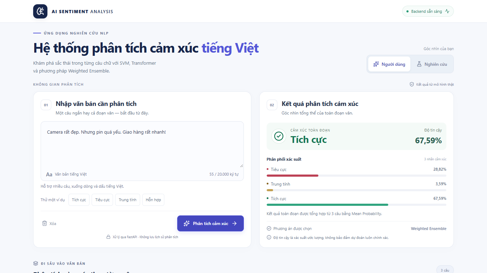
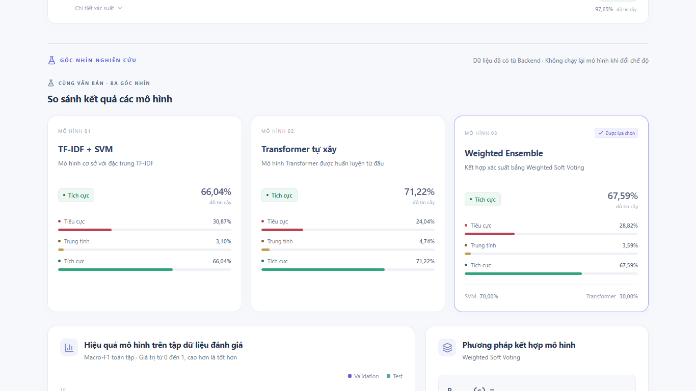

# Phân tích cảm xúc tiếng Việt đa nguồn

Hệ thống phân loại **tiêu cực, trung tính, tích cực** bằng TF-IDF + SVM và Transformer tự xây dựng, có FastAPI backend và React frontend.

**Phiên bản demo hiện tại:** Transformer checkpoint **epoch 21**, Weighted Ensemble **70% SVM + 30% Transformer**. Trọng số được chọn theo Macro-F1 trên Validation, không chọn bằng Test. Repo kèm mô hình đã huấn luyện để chạy demo; không cần train lại.



## Ba phần của đề tài

1. **NLP truyền thống:** chuẩn hóa dữ liệu, Word/Char TF-IDF, Linear SVM và hiệu chỉnh sigmoid năm phần trên Train.
2. **Transformer:** Encoder tự xây bằng PyTorch, học từ đầu, không sử dụng trọng số BERT/PhoBERT. Huấn luyện tối đa 30 epoch, dừng sớm ở epoch 24, chọn checkpoint epoch 21 bằng Validation.
3. **Kết hợp và ứng dụng:** lựa chọn alpha trên Validation, đối chiếu Max Confidence, kiểm định và phân tích theo nguồn; tách câu và tổng hợp đoạn; API và giao diện.

## Chạy demo

Môi trường đã kiểm chứng: Windows, Python 3.13, Node.js 24.15, CPU. Các phiên bản thư viện được ghi trong requirements và package-lock.

```powershell
git clone https://github.com/nhatshine/vietnamese-sentiment-system.git
cd vietnamese-sentiment-system
python -m pip install -r backend/requirements-api.txt
cd frontend
npm ci
cd ..
```

Trên Windows, nháy đúp **CHAY_HE_THONG.cmd** trong thư mục repo. Đợi nạp mô hình rồi mở **http://localhost:5173**. Launcher dùng Python Miniconda của tài khoản hiện tại nếu có, hoặc Python trên PATH; hãy cài thư viện vào đúng môi trường đó.

Hoặc chạy hai terminal từ thư mục repo:

```powershell
# Terminal 1
$env:OMP_NUM_THREADS='1'
$env:MKL_NUM_THREADS='1'
python -X utf8 -m uvicorn backend.src.api:app --host 127.0.0.1 --port 8000
```

```powershell
# Terminal 2
cd frontend
npm run dev
```

API: http://127.0.0.1:8000/docs. Cấu hình đang phục vụ: http://127.0.0.1:8000/api/model-info. Chuyển sang **Nghiên cứu** trên giao diện để xem kết quả từng mô hình và trọng số 70/30. Chuyển chế độ dùng lại kết quả đã nhận.

Các tệp mô hình nằm trong `backend/models`; dấu vân tay ở [MODEL_ARTIFACTS.json](MODEL_ARTIFACTS.json). Cấu hình triển khai kiểm tra SHA-256 của mô hình và mã suy luận. Giữ nguyên byte của các tệp này; `.gitattributes` tắt chuyển đổi xuống dòng tự động để bản clone nạp đúng cấu hình đã kiểm chứng.

## Kết quả chính

Cùng 8.238 mẫu Validation và 8.238 mẫu Test, thứ tự nhãn `negative, neutral, positive`:

| Phương pháp | Validation Macro-F1 | Test Macro-F1 |
|---|---:|---:|
| TF-IDF + SVM đã hiệu chỉnh | 0,824149 | 0,818605 |
| Transformer epoch 21 | 0,807684 | 0,804910 |
| Max Confidence | 0,820965 | 0,821084 |
| Weighted Ensemble 70/30 | **0,824976** | **0,825271** |

Test Accuracy của Ensemble: **82,45%**. McNemar có hiệu chỉnh liên tục: Ensemble–SVM `p = 0,002422`, Ensemble–Max Confidence `p = 0,033895`. Paired bootstrap 10.000 lần, seed 42, cho 95% CI của chênh lệch Macro-F1 lần lượt `[0,002492; 0,010914]` và `[0,000428; 0,007891]`. Các phép so sánh chưa hiệu chỉnh nhiều kiểm định.

Ensemble cao hơn SVM trên Test ở cả ba nguồn, nhưng không đứng đầu mọi nguồn: trên UIT-VSFC, Transformer riêng lẻ cao hơn Ensemble. Đây là kết quả của cấu hình và dữ liệu đã khảo sát, không chứng minh ưu thế trên mọi miền dữ liệu.

- [Các chỉ số toàn tập](results/epoch21/metrics.csv)
- [Kết quả từng lớp](results/epoch21/per_class_metrics.csv)
- [Kết quả theo nguồn và Source-only](results/epoch21/source_metrics.csv)
- [McNemar và bootstrap](results/epoch21/statistical_tests.csv)
- [Điểm khi chọn alpha trên Validation](results/epoch21/validation_alpha_scores.csv)
- [Biểu đồ](results/epoch21/figures)

### Tái tính kết quả không cần văn bản gốc

Repo kèm xác suất đã ghép đúng thứ tự mẫu, nhãn thật và mã nguồn dữ liệu, không kèm văn bản. Chạy:

```powershell
python -X utf8 -m scripts.reproduce_metrics
```

Lệnh dùng lại các hàm tính alpha và Max Confidence trong backend: chọn alpha từ Validation trước, sau đó tính các chỉ số trên Test và đối chiếu số liệu đã lưu. Nó không huấn luyện hay thay đổi cấu hình demo. Muốn tái chạy suy luận trên toàn bộ văn bản cần chuẩn bị lại các CSV gốc theo phần dữ liệu dưới đây.

## Dữ liệu và huấn luyện

Ba nguồn được dùng:

| Dataset | Mẫu sau xử lý trong đề tài | Nội dung |
|---|---:|---|
| [Vietnamese SA](https://huggingface.co/datasets/h-i-e-u/vietnamese-SA-dataset) | 33.718 | Nhận xét sản phẩm và bình luận nhiều chủ đề |
| [NEU-ESC](https://huggingface.co/datasets/hung20gg/NEU-ESC) | 32.696 | Bình luận về giáo dục và đời sống sinh viên |
| [UIT-VSFC](https://huggingface.co/datasets/uitnlp/vietnamese_students_feedback) | 15.961 | Phản hồi của sinh viên |

Tổng sau xử lý: **82.375 mẫu**, chia Train **65.899**, Validation **8.238**, Test **8.238**, theo nguồn và nhãn. Đây là quy mô sử dụng trong đề tài, không phải quy mô nguyên bản của các dataset.

Repo không phân phối các CSV chứa văn bản hoặc dữ liệu đăng nhập. Tải dữ liệu từ nguồn gốc và kiểm tra điều kiện sử dụng của từng bộ. Mã chuẩn hóa/gộp/chia dữ liệu và huấn luyện SVM ở [training/svm](training/svm); mã huấn luyện Transformer mới ở [training/transformer](training/transformer). Các tệp CSV cần có cột `text,label,source`, nhãn `0,1,2`.

```powershell
# Chỉ chạy khi muốn huấn luyện một thí nghiệm mới và đã chuẩn bị data/final
python -m pip install -r training/svm/requirements.txt
python training/svm/src/train_svm.py --data-dir data/final

# Transformer: chọn checkpoint bằng Validation, dùng thư mục output riêng
python training/transformer/train_transformer.py --data-dir data/final --out-dir runs/transformer --epochs 30 --patience 3
```

Không dùng kết quả Test để chọn lại C, epoch hoặc alpha. Các lệnh train không cần thiết để chạy bản demo đã bàn giao.

## Kiểm thử

Từ thư mục repo:

```powershell
$env:OMP_NUM_THREADS='1'
$env:MKL_NUM_THREADS='1'
python -X utf8 -m unittest discover -s backend/tests -q
```

Trong thư mục frontend:

```powershell
npm run typecheck
npm test
npm run build
$env:E2E_RESULTS_DIR='e2e-results-epoch21'
npm run test:e2e
```

Kiểm thử trình duyệt dùng Chrome và hai dịch vụ local. Bản clone không kèm dữ liệu văn bản chạy 445 bài kiểm thử backend và bỏ qua có thông báo bốn bài kiểm tra cache cần CSV Validation gốc. Đặt đúng `val.csv` vào `backend/data/val.csv` để chạy đủ 449 bài; tệp này được Git bỏ qua. Các công cụ kiểm chứng suy luận trên CSV cũng cần dữ liệu gốc; các cache kết quả trong repo phục vụ kiểm chứng số liệu và các bài kiểm thử tương ứng.

## Cấu trúc và giới hạn

```text
backend/src/                    NLP, mô hình, kết hợp, API
backend/models/                 Các mô hình đã huấn luyện
backend/config/                 Cấu hình hiện hành epoch 21, alpha 0.7
backend/outputs/epoch21_deployment/  Bản khóa và số liệu cấu hình hiện hành
backend/tests/                  Kiểm thử Python
frontend/                       React, TypeScript, Vite
training/svm/                   Mã chuẩn hóa/chia dữ liệu và train SVM
training/transformer/           Mã train/evaluate Transformer mới
results/epoch21/                 Kết quả kết hợp mới và xác suất đã ghép
results/transformer_epoch21/     Lịch sử và đánh giá Transformer
scripts/reproduce_metrics.py     Tái tính điểm bằng xác suất đã lưu
```

Các thư mục thí nghiệm khác dưới `backend/outputs` và tài liệu tích hợp các bước trước được giữ để truy vết lịch sử. Chúng có thể chứa trọng số/kết quả cũ; cấu hình demo hiện hành được xác định bởi `backend/config/deployment_selection.json` và profile `transformer_epoch21`.

Với đoạn nhiều câu, mặc định lấy trung bình xác suất từng câu (**Mean Probability**); các cách tổng hợp khác chỉ để đối chiếu. Chưa có bộ nhãn chuẩn toàn đoạn để chứng minh cách này tối ưu. Confidence của một văn bản không phải Accuracy hoặc Macro-F1 của toàn hệ thống. Hệ thống còn hạn chế với mỉa mai, ngữ cảnh phức tạp và nguồn chưa thấy.


