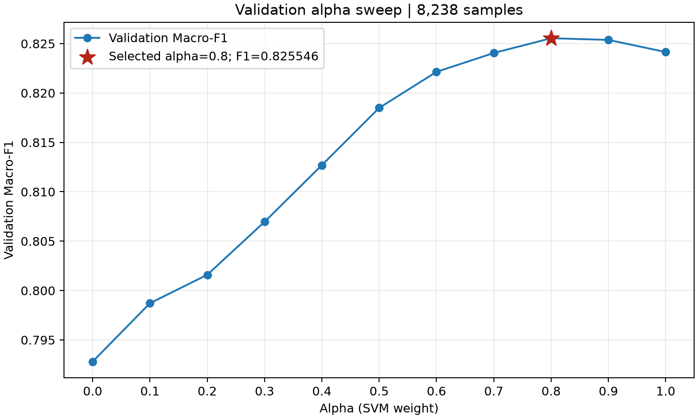

# Thực nghiệm tuning alpha trên Validation – Bước 9

## Mục tiêu và phạm vi

Trả lời RQ2: trọng số kết hợp TF-IDF + SVM và Transformer ảnh hưởng thế nào
đến Macro-F1 trên Validation? Chỉ tìm alpha trên lưới đã định trước, không
chọn BEST_METHOD hoặc aggregation method, không đánh giá cuối trên Test.

```text
P_ensemble(c) = alpha * P_svm(c) + (1 - alpha) * P_transformer(c)
```

Alpha 0 tương đương Transformer, alpha 1 tương đương SVM. Không giả định
phương án kết hợp phải thắng hai mô hình đơn lẻ.

## Validation và kiểm tra tính nhất quán

Đầu vào: `backend/data/val.csv`, **8.238 mẫu**, đủ text/label/source, không
có text/label rỗng, chỉ class IDs 0/1/2. Phân bố label: negative 2775,
neutral 2785, positive 2678. Không bỏ dòng, lọc trùng hoặc chia lại dataset.

File này được copy nguyên byte từ:
`C:/Users/Admin/data+model_SVM/data_final/final/val.csv`.
Bản bàn giao SVM trùng nguyên byte với `data/val.csv` trong Transformer ZIP.
Cả hai khớp hash Validation trong config huấn luyện Transformer:

```text
e4f5ed62299115d4f726331c47482d3195bd006adcf58223ddb64718c50156c7
```

Lưu nguồn và các kiểm tra ở `backend/data/validation_provenance.json`.
Metadata model SVM không có SHA riêng của dataset khi train; không tự tạo
thông tin này. Đối với SVM, xác minh dựa trên CSV bàn giao của Phần 1, việc
trùng byte giữa hai bộ bàn giao và fingerprint artifact. Với Transformer,
có thêm checksum training config khớp chính xác. Dữ liệu lệch hash, thiếu
cột, sai label/source hoặc sai số dòng làm script dừng trước inference.

| Source | Số mẫu |
|---|---:|
| hieu_sa | 3372 |
| neu_esc | 3270 |
| vsfc | 1596 |

## Inference cleaned text, không double preprocessing

CSV đã được preprocessing. Không dùng predictor raw text để đánh giá CSV:

- `predict_svm_cleaned_batch()` gọi pipeline.predict_proba theo batch,
  tái sử dụng model đã cache và mapping classes_ hiện có, không gọi clean_text.
- `predict_transformer_cleaned_batch()` dùng model/config/vocab đã cache,
  model.eval() từ loader và torch.inference_mode().
- `encode_cleaned_text()` dùng text.split() và giữ đúng CLS/UNK/PAD,
  truncation 127 token nội dung, max_len 128 và attention mask của tokenizer
  gốc; bỏ duy nhất lời gọi clean_text vốn có trong tokenize của đường raw.
- Không sửa tokenizer, preprocessing gốc, weights hoặc hành vi raw predictor
  Bước 7–8. Test đối chiếu trên fixture đã làm sạch và chặn clean_text bằng spy.

Hai model chạy cùng list text theo nguyên thứ tự CSV. Kết quả có cùng shape
`(8238,3)`, cột luôn `[negative, neutral, positive]`. SVM ánh xạ theo classes_
thực tế `[0,1,2]`; Transformer theo label_map.json. Ground truth không đổi.
Không segmentation hoặc document aggregation trong thực nghiệm này.

Mỗi model chạy **một lượt**, SVM batch 256 và Transformer CPU batch 64.
Các alpha chỉ kết hợp lại hai ma trận probability, không chạy inference 11 lần.

## Metric và tie-break

Lấy argmax của probability kết hợp rồi dùng sklearn.metrics trên toàn bộ
Validation. Macro Precision/Recall/F1 dùng average="macro", zero_division=0
và cố định cả ba class IDs. Macro-F1 là trung bình F1 của ba lớp tính từ
prediction toàn tập, không phải trung bình Macro-F1 của hai model.

Lưới: `0.0, 0.1, ..., 1.0`. Tiêu chí duy nhất là Validation Macro-F1.
Nếu nhiều alpha hòa **chính xác**: ưu tiên endpoint trước mixture; giữa
hai endpoint chọn 0 trước 1; nếu chỉ mixture hòa thì chọn alpha nhỏ nhất.
Quy tắc độc lập thứ tự grid và được kiểm tra bằng unit test.

Vector hóa dùng đúng công thức ensemble.py. Unit test đối chiếu từng hàng
với engine hiện có, kiểm tra hai endpoint, validation input và không mutate.

## Kết quả thực nghiệm ngày 29/10/2026

| Alpha | Accuracy | Macro Precision | Macro Recall | Macro-F1 |
|---:|---:|---:|---:|---:|
| 0.0 | 0.79206118 | 0.79339203 | 0.79241326 | 0.79280556 |
| 0.1 | 0.79788784 | 0.79956576 | 0.79818302 | 0.79871775 |
| 0.2 | 0.80080117 | 0.80245926 | 0.80105724 | 0.80159422 |
| 0.3 | 0.80614227 | 0.80796109 | 0.80636436 | 0.80695928 |
| 0.4 | 0.81184754 | 0.81388003 | 0.81203227 | 0.81269753 |
| 0.5 | 0.81767419 | 0.81977807 | 0.81781378 | 0.81849389 |
| 0.6 | 0.82131585 | 0.82353467 | 0.82143659 | 0.82214193 |
| 0.7 | 0.82325807 | 0.82537215 | 0.82338638 | 0.82405119 |
| **0.8** | **0.82483613** | **0.82662279** | **0.82498232** | **0.82554567** |
| 0.9 | 0.82471474 | 0.82642657 | 0.82483174 | 0.82537737 |
| 1.0 | 0.82350085 | 0.82523915 | 0.82360271 | 0.82414943 |

Chọn **alpha*=0.8**, tức SVM 80%, Transformer 20%, duy nhất trên lưới này:

- SVM Validation Macro-F1: **0.824149428830137**.
- Transformer Validation Macro-F1: **0.7928055628236055**.
- Ensemble tại alpha*: **0.8255456672498939**.
- Chênh so SVM: **+0.00139623841975689**, khoảng **+0.1396 điểm phần trăm**.
- Chênh so Transformer: **+0.032740104426288386**, khoảng **+3.2740 điểm phần trăm**.

Baseline được tính lại từ probability thật. Đã assert alpha 0 cho đúng cùng
nhãn/Macro-F1 với Transformer, alpha 1 cho đúng cùng nhãn/Macro-F1 với SVM.
Không sử dụng baseline hard-code hoặc lựa chọn từ metadata cũ.



## Phân tích bổ sung theo source

Chỉ dùng **cùng alpha*=0.8** cho ba nguồn, không tuning theo source:

| Source | N | SVM Macro-F1 | Transformer Macro-F1 | Ensemble alpha=0.8 |
|---|---:|---:|---:|---:|
| hieu_sa | 3372 | 0.75931113 | 0.71715125 | 0.76217551 |
| neu_esc | 3270 | 0.71454810 | 0.67099435 | 0.70939957 |
| vsfc | 1596 | 0.69857928 | 0.69065702 | 0.69693417 |

Ensemble tăng ở hieu_sa nhưng giảm so SVM ở neu_esc và vsfc. Không kết luận
cải thiện ổn định trên mọi source. Macro-F1 toàn tập không phải trung bình
các Macro-F1 theo source; không dùng bảng này để thay tiêu chí chọn alpha.

## Tái lập và output

```powershell
python -m unittest discover backend/tests
python -m backend.run_alpha_tuning
```

Script cố định Validation val.csv; không có tùy chọn CLI chuyển sang Test.
Đường đọc dữ liệu từ chối basename test.csv trước khi mở file.
Output trong `backend/outputs/alpha_tuning/`:

- `alpha_scores.csv`: đủ 11 alpha với Accuracy và ba macro metric, full precision.
- `alpha_selection.json`: alpha và score thật, baseline/delta, source counts,
  provenance/hash, class mapping, grid/tie-break, package versions và code/model
  fingerprints. Kiểm tra fingerprints trước/sau inference để phát hiện thay đổi.
- `alpha_vs_macro_f1.png`: biểu đồ Validation, đánh dấu alpha 0.8.
- `val_probabilities.npz`: hai ma trận aligned, y_true, source và fingerprints;
  chỉ lưu để audit/tái lập bằng dữ liệu số, không tự đọc cache ở lần chạy sau.

Mỗi lần chạy script tính fresh probability, không dùng cache cũ. NPZ chỉ
chứa numeric/Unicode arrays, đọc được với allow_pickle=False. Không load model
hoặc checkpoint trong các hàm alpha_tuning thuần toán học.

Môi trường: Python 3.13.13, NumPy 2.3.5, sklearn 1.9.1, torch 2.14.0+cpu,
joblib 1.6.0, matplotlib 3.11.1; các package đã có sẵn, không đổi môi trường
toàn máy. Thêm matplotlib đã kiểm chứng vào requirements để vẽ PNG.

## Hạn chế và tránh data leakage

SVM đã calibration, nhưng điều đó không bảo đảm probability hai model có
cùng mức calibration; softmax Transformer có thể tự tin sai. Alpha phụ
thuộc các model/artifact và dataset hiện tại, không suy rộng cho mọi miền.
Mức tăng so SVM nhỏ và được chọn trên chính Validation, chưa phải bằng
chứng cải thiện trên Test hoặc ý nghĩa thống kê. Chưa thử alpha ngoài 11
điểm, không gọi đây là tối ưu toàn cục.

Không mở Test CSV, không đánh giá cuối hoặc tính Macro-F1 Test. Không retrain,
fine-tune, sửa dataset/preprocessing/weights hay công thức aggregation.
Alpha 0.5 ở pipeline/demo cũ vẫn giữ nguyên; kết quả 0.8 chỉ được lưu trong
output thực nghiệm. Chưa chọn BEST_METHOD hoặc BEST_AGGREGATION, chưa xây API/React.
Khóa lựa chọn Validation trước mọi đánh giá Test sau này. Dừng tại Bước 9.

## File tạo/sửa

Tạo alpha_tuning.py, run_alpha_tuning.py, test_alpha_tuning.py, tài liệu này;
copy Validation đã xác minh vào backend/data/val.csv và lưu provenance JSON.
Thêm bốn output thực nghiệm. Chỉ bổ sung cleaned-batch APIs vào real_svm.py
và real_transformer.py; giữ nguyên toàn bộ hàm raw đã có. Cập nhật requirements,
README và tài liệu contract/Weighted Ensemble. Không sửa test cũ.
