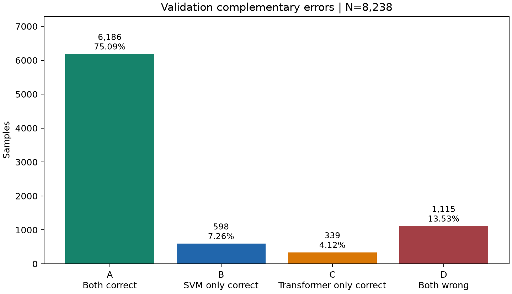
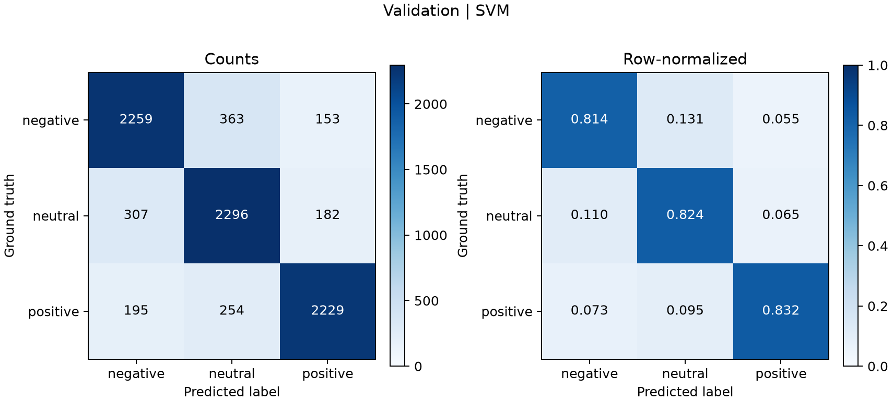
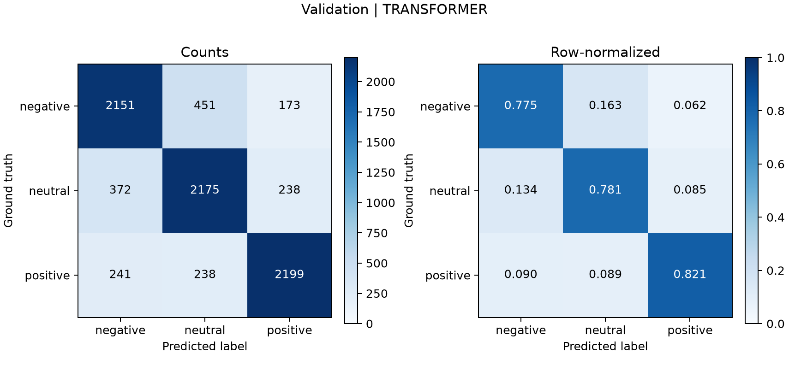
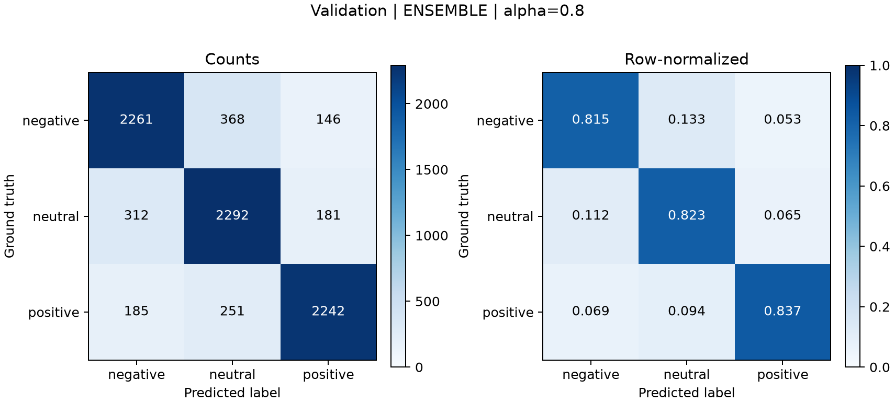
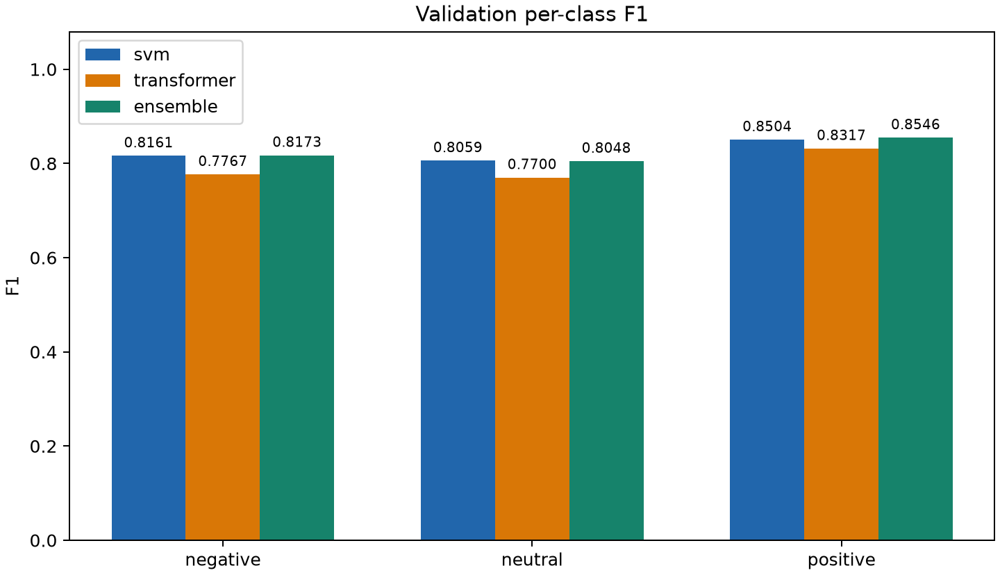
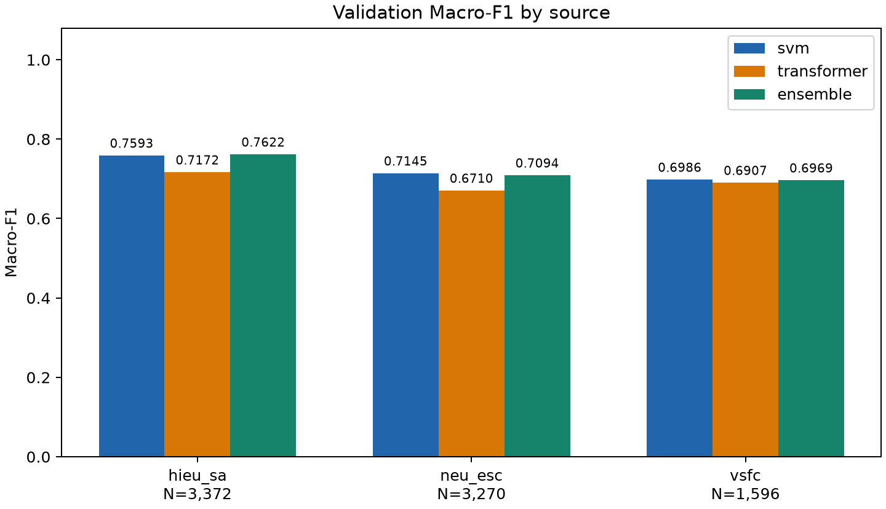
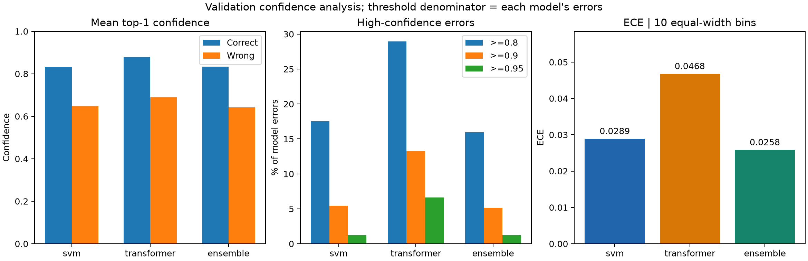
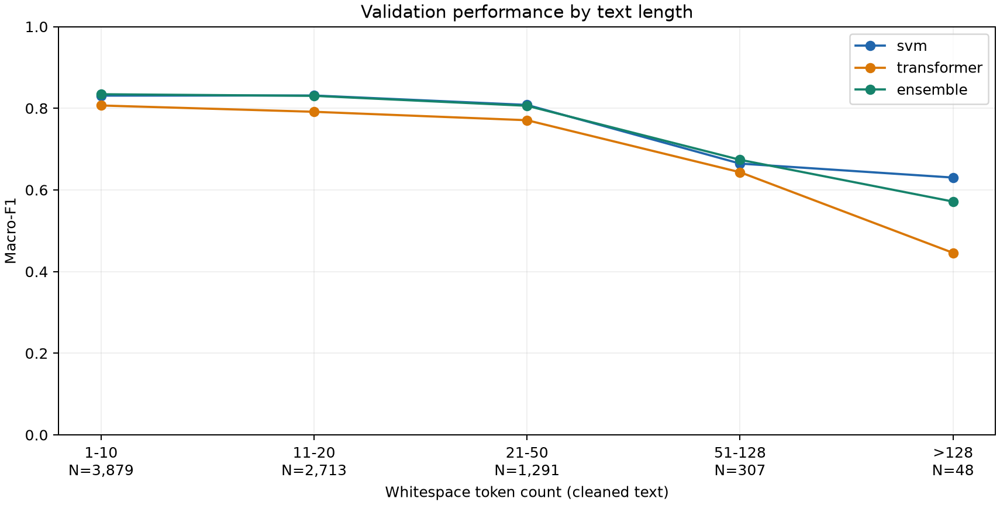

# Error Analysis & Model Complementarity – Bước 9.1


## A. Dataset và phạm vi

Validation: **8,238 mẫu**, alpha cố định **0.8** đọc từ alpha_selection.json. Cache **reused**, không sweep alpha, không sửa kết quả Bước 9.

Dữ liệu đã cleaned; không gọi clean_text(). Hash, ground truth và source từng dòng, mapping ba nhãn và toàn bộ fingerprints model/config/vocab/code đã đối chiếu. Sample index từ 0, giữ thứ tự CSV. Macro-F1 khớp Bước 9 với tolerance 1e-12.


| Model | Accuracy | Macro Precision | Macro Recall | Macro-F1 |
|---|---|---|---|---|
| svm | 0.8235008497 | 0.8252391535 | 0.8236027122 | 0.8241494288 |
| transformer | 0.7920611799 | 0.7933920270 | 0.7924132633 | 0.7928055628 |
| ensemble | 0.8248361253 | 0.8266227895 | 0.8249823201 | 0.8255456672 |


## B. Complementary errors – RQ-A


| Nhóm | Mô tả | N | Tỷ lệ |
|---|---|---|---|
| A | both_correct | 6186 | 75.0910% |
| B | svm_correct_transformer_wrong | 598 | 7.2590% |
| C | svm_wrong_transformer_correct | 339 | 4.1151% |
| D | both_wrong | 1115 | 13.5348% |


Tổng bốn nhóm = 8238. SVM đúng/sai = 6784/1454; Transformer đúng/sai = 6525/1713.

Transformer rescue rate = C / SVM errors = 0.233150; SVM rescue rate = B / Transformer errors = 0.349095. Mẫu số 0 trả null/N/A, không coi là tỷ lệ 0.





## C. Lỗi Ensemble và Accuracy khác Macro-F1


| Chuyển đổi | N |
|---|---|
| svm_wrong_to_ensemble_correct | 101 |
| svm_correct_to_ensemble_wrong | 90 |
| transformer_wrong_to_ensemble_correct | 508 |
| transformer_correct_to_ensemble_wrong | 238 |
| both_wrong_to_ensemble_correct | 0 |
| both_correct_to_ensemble_wrong | 0 |


Ensemble tăng ròng 11 mẫu đúng so SVM: delta Accuracy=0.0013352756, delta Macro-F1=0.0013962384. Đây là hai đại lượng khác nhau, không dùng số mẫu đúng thay cho Macro-F1.

Cả hai model sai nhưng Ensemble đúng được đếm trực tiếp, không giả định bằng 0. Nếu hai model có các đỉnh sai ở hai class khác nhau, phép cộng probability có thể làm class đúng thắng. Unit test có counterexample synthetic; đó không phải kết quả quan sát thật. Nếu cả hai đều ưu tiên cùng một class sai hơn class đúng, convex average không sửa được tình huống đó.


## D. Confusion matrices và per-class – RQ-B


Hàng = ground truth, cột = predicted label; thứ tự negative, neutral, positive. Ảnh có cả counts và row-normalized.

- svm: nhầm nhiều nhất **negative → neutral**, 363 mẫu.





- transformer: nhầm nhiều nhất **negative → neutral**, 451 mẫu.





- ensemble: nhầm nhiều nhất **negative → neutral**, 368 mẫu.





| Model | Label | Precision | Recall | F1 | Support |
|---|---|---|---|---|---|
| svm | negative | 0.818182 | 0.814054 | 0.816113 | 2775 |
| svm | neutral | 0.788191 | 0.824417 | 0.805897 | 2785 |
| svm | positive | 0.869345 | 0.832338 | 0.850439 | 2678 |
| transformer | negative | 0.778220 | 0.775135 | 0.776674 | 2775 |
| transformer | neutral | 0.759427 | 0.780969 | 0.770048 | 2785 |
| transformer | positive | 0.842529 | 0.821135 | 0.831694 | 2678 |
| ensemble | negative | 0.819797 | 0.814775 | 0.817278 | 2775 |
| ensemble | neutral | 0.787358 | 0.822980 | 0.804775 | 2785 |
| ensemble | positive | 0.872713 | 0.837192 | 0.854584 | 2678 |


| Class | Ensemble F1 - SVM F1 |
|---|---|
| negative | +0.00116543 |
| neutral | -0.00112152 |
| positive | +0.00414481 |


Class có F1 thấp nhất của từng model: svm=neutral; transformer=neutral; ensemble=neutral.





## E. Phân tích source – RQ-D


| Source | N | SVM F1 | Transformer F1 | Ensemble F1 | TF cứu SVM | Both wrong | Ensemble cứu/mất so SVM |
|---|---|---|---|---|---|---|---|
| hieu_sa | 3372 | 0.759311 | 0.717151 | 0.762176 | 133 | 506 | 47/32 |
| neu_esc | 3270 | 0.714548 | 0.670994 | 0.709400 | 159 | 492 | 38/49 |
| vsfc | 1596 | 0.698579 | 0.690657 | 0.696934 | 47 | 117 | 16/9 |


Nguồn khó nhất theo Macro-F1 của từng model: svm=vsfc; transformer=neu_esc; ensemble=vsfc.

Nguồn có nhiều mẫu SVM sai/Transformer đúng nhất: neu_esc.

Source_error_analysis.csv chứa cả Accuracy, F1 từng class, class support, correct/wrong counts và rescue/loss. Không suy ra label noise hoặc domain shift chỉ từ khác biệt source. Macro-F1 toàn tập không phải trung bình F1 các source.

Thay đổi Ensemble so SVM theo từng nguồn: hieu_sa: delta Accuracy=+0.00444840, delta Macro-F1=+0.00286438; neu_esc: delta Accuracy=-0.00336391, delta Macro-F1=-0.00514853; vsfc: delta Accuracy=+0.00438596, delta Macro-F1=-0.00164511. Accuracy và Macro-F1 có thể chuyển động ngược chiều.





## F. Confidence và calibration – RQ-C


| Model | Mean correct | Mean wrong | Median wrong | Wrong ≥.8 | Wrong ≥.9 | Wrong ≥.95 | ECE |
|---|---|---|---|---|---|---|---|
| svm | 0.832002 | 0.646584 | 0.627283 | 0.175378 | 0.054333 | 0.012380 | 0.028902 |
| transformer | 0.878210 | 0.688904 | 0.673303 | 0.289550 | 0.133100 | 0.065966 | 0.046784 |
| ensemble | 0.833300 | 0.641228 | 0.619681 | 0.159390 | 0.051282 | 0.012474 | 0.025832 |


Các tỷ lệ threshold dùng mẫu số **số prediction sai của chính model**, không phải N toàn tập. So sánh >= trên probability full precision.

ECE = Σ_b (n_b/N) × |accuracy_b - mean_confidence_b|. Dùng 10 equal-width bins [0,.1),...,[.9,1], bin cuối gồm 1; bin rỗng đóng góp 0. ECE là top-label calibration error phụ thuộc cách chia bin, không phải metric class-wise đầy đủ.

| Model | Mean confidence toàn tập | Accuracy | Confidence - Accuracy |
|---|---|---|---|
| svm | 0.799276 | 0.823501 | -0.02422493 |
| transformer | 0.838846 | 0.792061 | +0.04678442 |
| ensemble | 0.799656 | 0.824836 | -0.02518044 |

Confidence cao không bảo đảm prediction đúng. Dấu của confidence-accuracy và reliability diagrams mới giúp phân biệt overconfidence/underconfidence; ECE tuyệt đối một mình không cho biết hướng.

Trên Validation này, độ lệch mean confidence - Accuracy: svm=-0.02422493 (underconfidence ở mức trung bình); transformer=+0.04678442 (overconfidence ở mức trung bình); ensemble=-0.02518044 (underconfidence ở mức trung bình). Đây là chẩn đoán top-label trên tập hiện tại, không phải kết luận cho mọi miền dữ liệu.





## G. Oracle potential


Oracle accuracy = 0.8646516145; oracle Macro-F1 = 0.8651427798. Quy tắc: nếu ít nhất một model đúng thì dùng ground truth, nếu cả hai sai dùng prediction SVM. Oracle dùng ground truth, không deploy được và không phải mô hình thật. Accuracy này là tiềm năng chọn giữa hai hard labels, không phải upper bound cho mọi probability ensemble (ensemble có thể cứu nhóm cả hai hard label sai).


## H. Độ dài văn bản


| Tokens | N | SVM F1 | Transformer F1 | Ensemble F1 | Class counts | Vượt limit nội dung |
|---|---|---|---|---|---|---|
| 1-10 | 3879 | 0.830903 | 0.806777 | 0.834318 | {"negative": 1221, "neutral": 1339, "positive": 1319} | 0 |
| 11-20 | 2713 | 0.831258 | 0.791321 | 0.830394 | {"negative": 973, "neutral": 779, "positive": 961} | 0 |
| 21-50 | 1291 | 0.808181 | 0.770669 | 0.806007 | {"negative": 467, "neutral": 465, "positive": 359} | 0 |
| 51-128 | 307 | 0.664465 | 0.643325 | 0.673758 | {"negative": 102, "neutral": 173, "positive": 32} | 2 |
| >128 | 48 | 0.630229 | 0.445824 | 0.571422 | {"negative": 12, "neutral": 29, "positive": 7} | 48 |


Độ dài = text.split() trên text cleaned, không preprocessing. N<30 được gắn small_sample; nhãn thiếu được ghi rõ, Macro-F1 vẫn cố định ba lớp. Ngay cả nhóm có đủ ba nhãn cũng có thể có class support nhỏ; xem class_counts. Nhóm không có mẫu trả N/A, không ghi F1 giả bằng 0.

Limit nội dung model = 127 token vì phải dành 1 vị trí CLS. Có 50 mẫu vượt limit này. Đây là exposure theo tokenizer/config, chưa chứng minh truncation là nguyên nhân lỗi. Khác biệt F1 theo độ dài còn chịu ảnh hưởng class/source mix và sample size; không có thử nghiệm nhân quả trong bước này.

Nhóm dài nhất có 48 mẫu, class counts={"negative": 12, "neutral": 29, "positive": 7}; cần thận trọng vì subgroup/class support nhỏ. Mức giảm Macro-F1 từ 1-10 token đến >128 token: svm=0.200673; transformer=0.360953; ensemble=0.262896. Cả SVM cũng thay đổi theo độ dài; chưa thể quy toàn bộ khác biệt cho truncation của Transformer.





## I. Ví dụ lỗi có tính quyết định


CSV giữ nguyên text và sample_index 0-based trong Validation. Chọn tối đa 10 mẫu mỗi nhóm theo confidence liên quan giảm dần, hòa thì index tăng; hợp các nhóm rồi deduplicate index. Đây là tập ví dụ có chủ đích, không phải random sample đại diện. error_group là complementary group, ensemble_effect là cột độc lập. Không tự gán nguyên nhân lỗi bằng keyword.


### svm_wrong_transformer_correct: index 1469 (hieu_sa)

True=positive; SVM=neutral (0.858061); Transformer=positive (0.509455); Ensemble=neutral (0.783730).


```text

nhé

```


### svm_correct_transformer_wrong: index 902 (hieu_sa)

True=positive; SVM=positive (0.636135); Transformer=negative (0.966779); Ensemble=positive (0.514082).


```text

áo không bị lỗi vải thun ổn phù hợp với giá tiền nói chung đáng mua

```


### both_wrong: index 182 (vsfc)

True=positive; SVM=negative (0.924610); Transformer=negative (0.993546); Ensemble=negative (0.938397).


```text

cần có nhiều giảng viên như cô dạy hơn

```


### ensemble_rescues_svm: index 436 (neu_esc)

True=positive; SVM=neutral (0.540822); Transformer=positive (0.942958); Ensemble=positive (0.543761).


```text

hello bạn tiên lâu ngày quá chúc tiên luôn thành công dù đi con đường nào nhé

```


### ensemble_hurts_svm: index 828 (hieu_sa)

True=positive; SVM=positive (0.497121); Transformer=negative (0.817112); Ensemble=negative (0.556284).


```text

áo mỏng quá phù hợp giá tiền

```


## J. Ba quan sát/giả thuyết nổi bật và khuyến nghị – RQ-E


1. **Ranh giới class**: nhóm cả hai sai có 1115 mẫu; các confusion counts/F1 ở mục D cho thấy nơi cần rà soát. Khó phân biệt ngữ nghĩa hoặc annotation ambiguity là giả thuyết cần kiểm tra thủ công, không phải kết luận nhãn sai. Không sửa preprocessing đang khớp hash chỉ để khớp ví dụ Validation.

2. **Calibration/Transformer**: Macro-F1 Transformer 0.792806 so SVM 0.824149; ECE 0.046784 so 0.028902; tỷ lệ lỗi confidence>=.9 là 13.31% so 5.43%. Ưu tiên **Phần 2** chẩn đoán lớp yếu và calibration trước khi tăng độ phức tạp Ensemble; không có bằng chứng ở đây rằng tăng head/layer sẽ tốt hơn.

3. **Độ dài/source**: F1 và class support theo nhóm ở mục E/H cho thấy độ ổn định khác nhau. Đây là liên hệ quan sát, không đủ kết luận domain shift hoặc truncation gây lỗi. Cần matched-case audit và thiết kế kiểm chứng riêng trong tương lai, không điều chỉnh model ở bước này.

**Data/preprocessing:** ưu tiên audit thủ công nhóm D (1115 mẫu), class/source có F1 yếu; kiểm tra hướng dẫn nhãn và tính đầy đủ thông tin trong cleaned text, chưa khẳng định label noise và không đổi dataset.

**SVM/Phần 1:** giữ làm baseline đối chiếu, tập trung cặp nhầm lớn nhất và neutral theo source từ bảng D/E; chưa thêm rule hoặc retrain theo ví dụ Validation.

**Phần 3:** Transformer có thể đúng ở 339 lỗi SVM, nhưng Ensemble chỉ sửa 101 và làm sai thêm 90. Có cơ sở nghiên cứu calibration/combination có điều kiện sau này, nhưng oracle cần ground truth nên không phải gating deployable. Mọi thử nghiệm mới cần protocol Validation đã định trước; không chọn alpha mới hoặc BEST_METHOD ở đây.


## K. Reproducibility và giới hạn


Chỉ Validation. Không mở test.csv, train/fine-tune, sửa model/weights/vocab/preprocessing, chọn BEST_METHOD hoặc aggregation tối ưu. Không chạy lại alpha sweep. Cache hợp lệ được tái sử dụng; chỉ fallback cleaned-batch khi cache lỗi nhưng frozen artifacts vẫn khớp; các metric lệch Bước 9 sẽ dừng trước khi xuất báo cáo.

summary.json ghi source fingerprints, hash selection/cache/CSV, mapping, cache status và kiểm tra baseline. Bước 9 đã chọn alpha trên chính Validation; phân tích này là diagnostic của tập đã dùng lựa chọn, không phải đánh giá tổng quát hóa độc lập hoặc chứng minh ý nghĩa thống kê.

Giới hạn alignment: cache Bước 9 không có text hash riêng từng dòng hoặc chữ ký integrity độc lập. Kiểm tra thứ tự dựa trên hash của toàn bộ CSV/script tạo cache và đối chiếu chính xác y_true/source từng dòng. Việc gắn probability với text còn dựa vào thứ tự mà script Bước 9 đã ghi; các kiểm tra này không phát hiện mọi hoán đổi probability giữa các dòng có cùng label/source nếu aggregate metrics vẫn giữ nguyên. Không quan sát thấy sai lệch cache trong lần chạy này; không inference lại chỉ để tạo bằng chứng mới.


```powershell

python -m unittest discover backend/tests

python -m backend.run_error_analysis

```


Dừng tại Bước 9.1; chưa thực hiện Bước 10.
